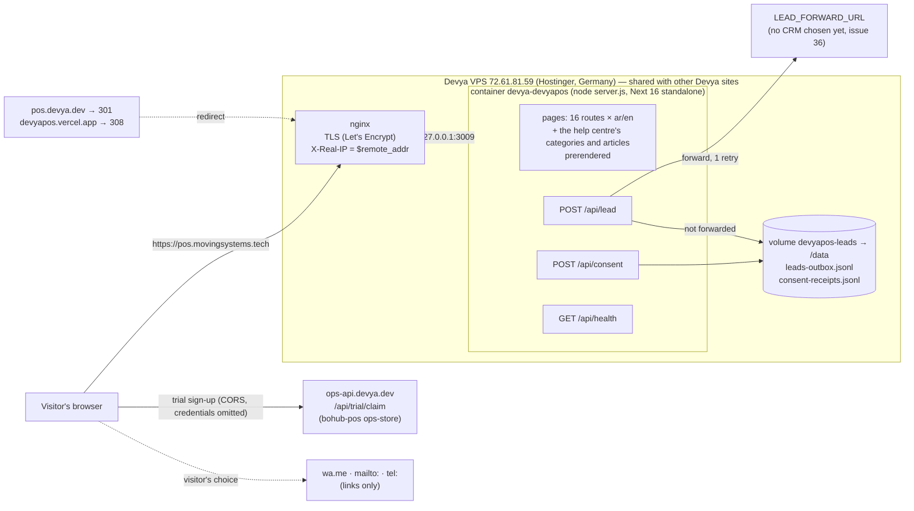

# Architecture — Moving POS marketing site

One page on how the site runs in production, as of 2026-10-22 (`main` after
the move to `pos.movingsystems.tech`). Why it is built this way is in
[`docs/decisions/`](decisions/README.md); the pages and the UI are in
[`docs/spec.md`](spec.md). Update this page in the same pull request as any
change to hosting, routes, sinks, environment or CI.

## The picture

## Request path

1. **DNS.** `pos.movingsystems.tech` and `pos.devya.dev` are DNS-only `A →
   72.61.81.59` records on Cloudflare (no proxy, so Cloudflare sees no visitor
   traffic). The legacy Vercel project only redirects: `devyapos.vercel.app`
   answers with a 308 to `pos.devya.dev`, which answers with a 301 here.
2. **nginx** on the VPS terminates TLS (one certificate for both names),
   redirects HTTP to HTTPS, answers `pos.devya.dev` with a 301 to the same path
   and query on `pos.movingsystems.tech`, and proxies everything else to
   `127.0.0.1:3009`. It sets `X-Real-IP $remote_addr`, which is the only client
   address the app trusts. The site file is [`deploy/nginx.conf`](../deploy/nginx.conf),
   installed by `bash scripts/deploy.sh --setup`; certbot adds the TLS lines on
   the host. Access logs: daily × 14 (`/etc/logrotate.d/nginx`).
3. **The container** (`docker-compose.prod.yml`) is published on loopback
   only. It runs Next's standalone server as an unprivileged user from an image
   pinned to one `node:24.22.1-alpine` digest (`Dockerfile`). One process, one
   container: in-memory state such as the rate limiter is exact and resets on
   every restart and deploy.
4. **Next.** `proxy.ts` sends `/` to `/ar` whatever `Accept-Language` says and
   adds the locale prefix to bare paths; it skips `/api`, `/moving-support`, `/_next` and files.
   Pages are prerendered for both locales at build time. `next.config.ts` adds
   the security headers: in production a same-origin CSP (plus the trial claim
   origin in `connect-src`) and HSTS. No `/api` rewrite: an unknown `/api`
   path is a 404. One rewrite: `/moving-support/*` → the Moving support
   assistant on `movingsystems.tech` ([ADR 0007](decisions/0007-moving-support-assistant.md)),
   which the layout's loader (`components/SupportChat.tsx`) and the floating
   stack's chat button use; to the browser it is this origin.

## The routes that do something

| Route | Accepts | Writes to | When it cannot write |
| --- | --- | --- | --- |
| `POST /api/lead` (`app/api/lead/route.ts`) | JSON only (415 otherwise), validated by `lib/leads.ts`; honeypot field `company`; 12 per 10 min per address (`lib/rate-limit.ts`) | 1. `LEAD_FORWARD_URL` (contract v1 in the README; a 4xx is final, a 5xx/timeout/network error retried once). 2. Otherwise `/data/leads-outbox.jsonl` | 503 — the form offers WhatsApp and email. One `[lead] LOST` line, no personal data |
| `POST /api/consent` (`app/api/consent/route.ts`) | One receipt per banner answer (`sendBeacon`), exact shapes only, ≤ 2,000 chars; 20 per 10 min per address | `/data/consent-receipts.jsonl`: id, time, policy version, choices, locale — no IP, user agent or visitor id | 503 and one `[consent] receipt NOT STORED` line |
| `GET /api/health` (`app/api/health/route.ts`) | — | nothing | Always 200 while the process answers: `{status, release, config, lead: {forward, outbox}}`, states only |

The accounting trial does **not** pass through this server: the browser posts
the sign-up straight to `NEXT_PUBLIC_TRIAL_CLAIM_URL` (baked at build;
production `https://ops-api.devya.dev/api/trial/claim`) with
`credentials: "omit"`, and shows the stack link and one-time token the claim
route returns ([ADR 0003](decisions/0003-trial-posts-direct-to-ops-api.md)).
That route must list `https://pos.movingsystems.tech` in its
`TRIAL_ALLOWED_ORIGINS` (configured in bohub-pos, not here).

## The data volume

`/data` is the named volume `devyapos-leads`. It survives deploys and
rollbacks; container logs do not. Both files are JSON lines, owner-only
(0600 in a 0700 directory), written through `lib/jsonl-sink.ts`: append-only
with `O_APPEND` + `datasync`, never rewritten except by retention pruning
(365 days each, on the first write after a start and then at most daily, via
an fsynced temp file and rename), capped at 32 MiB (outbox) and 64 MiB
(receipts) so a flood cannot fill a shared disk
([ADR 0002](decisions/0002-lead-outbox-and-jsonl-sinks.md)).
`bash scripts/leads.sh status` reports counts and ages with no personal data;
`bash scripts/leads.sh pull <dir>` copies both files off the box. Nothing
copies the volume off the box on a schedule yet
([#37](https://github.com/eng-AhmedMahmoud/devyapos/issues/37)).

## Deploy and rollback

`bash scripts/deploy.sh` (run from a laptop with SSH to the VPS and `gh`):

1. Refuses unless the newest GitHub Actions `check` run on the commit
   succeeded (`--skip-ci-check` overrides it and the record says so).
2. Sends a `git archive` of `origin/main` over SSH, keeps the running release
   under `/root/devyapos-pre-*` (without `.env.production.local`), rebuilds with
   `--pull` and `RELEASE=<sha>`, and starts the new container.
3. Smoke-tests `/ar`, `/en`, `/api/health` (must report this commit and
   `config: "ok"`) and a malformed `POST /api/lead` (must be 400).
4. Prunes backups to 5, writes `.deployed-commit` on the host and pushes the
   tag `release-<UTC yyyymmddHHMM>-<sha>`.

`--rollback` restores the newest backup with the live env file and pushes a
`rollback-…` tag. `--dry-run` runs the CI gate and prints the plan. Host-only
settings live in `.env.production.local` beside the release; deploy.sh moves
it from release to release and never copies it into a backup.

## CI gates

`main` is protected by a ruleset (ADR [0006](decisions/0006-protected-main-and-ci-gated-deploys.md)):
changes land only through a pull request that is up to date with `main` and
has passed both required checks, with no force-push or deletion.

| Job (`.github/workflows/ci.yml`) | Runs |
| --- | --- |
| `check` | `pnpm install --frozen-lockfile`, `pnpm audit --prod --audit-level high`, lint, `tsc --noEmit`, `pnpm test:coverage` against the floor in `vitest.config.mts`, `pnpm build` |
| `e2e` | A production build, then the Playwright journeys in `e2e/` (Chromium), failing on any console or page error |

Dependabot opens weekly npm, GitHub Actions and Docker digest updates; they
go through the same checks. GitHub secret scanning and push protection are
on, and `.githooks/pre-commit` scans each commit locally.

## Observability

There is no error tracker, uptime monitor or alert channel yet
([#37](https://github.com/eng-AhmedMahmoud/devyapos/issues/37)). What exists:
`/api/health`; the container healthcheck on it; one JSON line per server
error (`"event":"request_error"`, `instrumentation.ts`) and per bad setting at
boot (`"event":"config_problem"`, `lib/env.ts`); one `[lead] NOT FORWARDED` /
`[lead] LOST` line per lead that missed the forward. None of these lines
carries a name, phone, message or IP (`tests/privacy.test.ts`). Logs are
`json-file`, 10 MB × 3, and go with the container on every deploy.

## What lives elsewhere

| Where | What |
| --- | --- |
| The VPS host | nginx's TLS lines and certificates (certbot), `.env.production.local`, backups under `/root`, logrotate. The host also runs other Devya services; SSH is `root` today ([#38](https://github.com/eng-AhmedMahmoud/devyapos/issues/38)) |
| Cloudflare | DNS for `movingsystems.tech` and `devya.dev` (DNS-only) |
| Vercel | The legacy `devyapos` project, kept only for its 308 redirect |
| [bohub-pos](https://github.com/eng-AhmedMahmoud/bohub-pos) | The product (POS, KDS, shop, admin), the control plane `ops-store` behind `ops-api.devya.dev` that the trial posts to (its validation rules are copied in `lib/trial.ts`), and the source of every screenshot |
| devya-commerce | Moving Stores, whose palette, type and mark this site uses (`app/globals.css`, `components/Logo.tsx`) |
| moving-landing | The umbrella site `movingsystems.tech`, and the reference copy of the shared consent design ([`docs/compliance/consent-design.md`](compliance/consent-design.md)) |
| GitHub | The ruleset on `main`, Dependabot, secret scanning, release tags |
